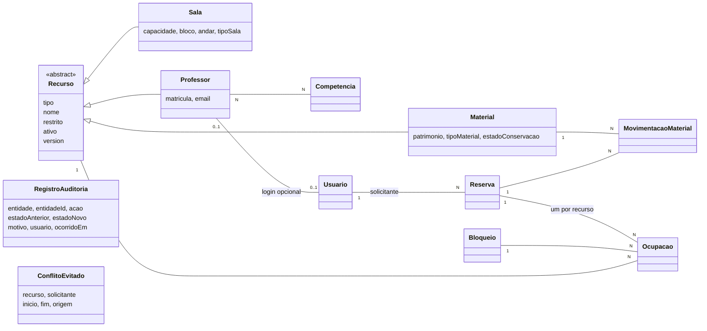
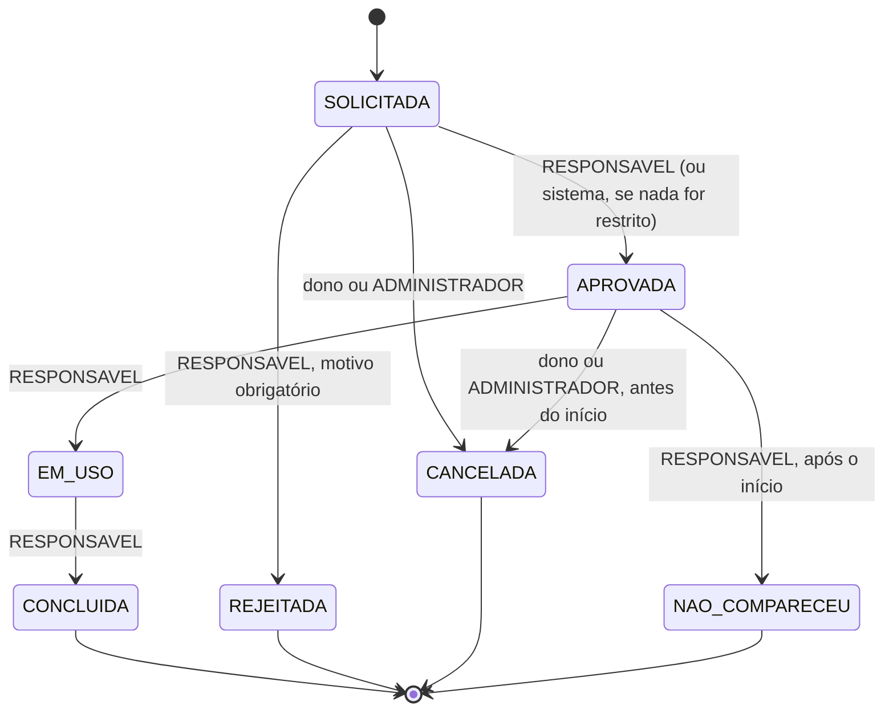

# Arquitetura e decisões de projeto

Registro das decisões da Fase 1. Cada decisão traz o **porquê**, para que qualquer integrante
consiga defendê-la. Mudou alguma decisão? Atualize este arquivo no mesmo PR.

## 1. Camadas e pacotes

```
br.senac.qs.recursos
├── domain            regras de negócio; não conhece HTTP
│   ├── model         entidades, value objects e enums
│   ├── repository    interfaces Spring Data
│   └── exception     exceções com mensagem para o usuário final (pt-BR)
├── application       casos de uso (@Transactional) e portas de saída (ex.: NotificadorPort)
├── infrastructure    configuração, segurança (JWT) e adaptadores (cliente HTTP de notificação)
└── web               controllers REST, DTOs (records) e handler global de erros (ProblemDetail)
```

Dependências permitidas: `web → application → domain`; `infrastructure` pode ver todas; `domain` não
depende de nenhuma. **Verificado no build** por `ArquiteturaTest` (ArchUnit).

- **Regras puras fora do Spring.** RC01, RC05 e a detecção de sobreposição ficam em objetos simples,
  testados com testes unitários parametrizados, sem mock.
- **Inversão de dependência só na integração externa.** `application` define `NotificadorPort`;
  `infrastructure` o implementa. Nos testes, o WireMock faz o papel do servidor externo.
- **Hexagonal pragmática.** Entidades com anotações JPA e repositórios Spring Data no `domain`. A
  versão "pura" exigiria dois modelos de cada entidade (domínio e persistência): custo alto para
  uma equipe de 4, com ganho pequeno neste projeto.
- **Controllers nunca expõem entidades**, só DTOs. Junto com `fail-on-unknown-properties`, isso
  impede *mass assignment* (ex.: o cliente enviar `"status": "APROVADA"`).

## 2. Modelo de domínio



| Decisão | Por quê |
|---|---|
| Sala, Professor e Material herdam de `Recurso` (JOINED) | Uma única coluna `recurso_id` e **uma única constraint** para os três tipos (a RC02 cita sala, material e professor). |
| Tabela `ocupacao` (recurso, período, bloqueante), alimentada por Reserva **ou** Bloqueio | RC02, RC03 e RC04 viram a mesma regra no banco. Uma reserva pode juntar sala, professor e materiais e é tudo ou nada. |
| Intervalo semiaberto `[inicio, fim)` | 08h–10h e 10h–12h **não** conflitam: intervalos que só se tocam são permitidos. |
| `PeriodoReserva` (value object) | Valida a RC01 no construtor e concentra `sobrepoe()`. É o alvo do TDD. |
| Única forma de mudar o estado: `Reserva.transitar(novo, usuario, motivo)` | Valida a RC05 e gera o `RegistroAuditoria` (RC08) no mesmo lugar. Não há `setStatus` público. |
| Datas em `Instant` / `TIMESTAMPTZ` (UTC) | Instante absoluto, sem ambiguidade de fuso. A API recebe ISO-8601 com offset e a interface exibe no horário de São Paulo. |
| Auditoria e reservas protegidas por trigger | Somente inserção na auditoria (V1); proibido DELETE em reservas (V2, RC07). Vale até contra SQL manual. |

### Máquina de estados (RC05)



São 7 estados, ou seja, 49 pares possíveis; só 7 são válidos. O teste parametrizado cobre os 49.
Ocupação **bloqueante** em SOLICITADA, APROVADA, EM_USO e CONCLUIDA; ao ir para REJEITADA,
CANCELADA ou NAO_COMPARECEU, `bloqueante = false` e o horário fica livre sem apagar nada.

## 3. Sobreposição e dupla reserva (RC02, RC03, RC04)

**O problema:** validar só na aplicação não basta. As transações T1 e T2 fazem o mesmo `SELECT`,
as duas veem o horário livre e as duas fazem `INSERT` (corrida *check-then-insert*).

| | `EXCLUDE USING gist` | `SELECT … FOR UPDATE` | `@Version` |
|---|---|---|---|
| Impede dois INSERTs simultâneos? | **Sim**: a 2ª transação espera a 1ª e falha com `23P01` | Só travando uma linha "pai" (o recurso); reserva inexistente não pode ser travada | **Não**: dois INSERTs não compartilham linha versionada |
| Onde fica a regra | No schema: vale para qualquer código, SQL manual ou várias instâncias | No código: todo caminho precisa lembrar de travar | No código |
| Custos | Só PostgreSQL; traduzir `23P01` em 409; índice GiST | Contenção; deadlock em reserva multi-recurso | Nova tentativa; falso conflito |
| Serve bem para | Garantir a regra "sem sobreposição" | Ler e modificar uma linha existente | Aprovar × cancelar a mesma reserva |

`SERIALIZABLE` também resolveria, mas exige nova tentativa após qualquer falha de serialização,
inclusive falsos positivos. Descartado.

**Escolha: defesa em três camadas.**

1. **Aplicação:** valida a RC01 e consulta conflitos antes de gravar. Gera uma mensagem útil e
   registra o conflito evitado com origem `APLICACAO`. Não garante nada sob concorrência.
2. **Banco:** `EXCLUDE USING gist (recurso_id WITH =, periodo WITH &&) WHERE (bloqueante)` é a
   **garantia real**. `23P01` vira `ConflitoHorarioException` (HTTP 409) e o conflito é registrado
   com origem `BANCO`. Usar `saveAndFlush` para o erro surgir dentro do caso de uso, e não no
   commit (onde viraria um 500).
3. **`@Version`** em Reserva e Recurso: transições concorrentes recebem 409 "edição concorrente".

**Por que funciona:** como `UNIQUE`, a constraint de exclusão também enxerga linhas ainda não
confirmadas de outra transação. T2 encontra a linha conflitante de T1 e **espera**. Se T1 confirmar,
T2 recebe `23P01`; se T1 desfizer, T2 segue. Exatamente uma reserva é aceita, já em `READ COMMITTED`.
A extensão `btree_gist` permite combinar `=` em `BIGINT` com `&&` em `tstzrange` no mesmo índice GiST.

## 4. Regras de negócio esclarecidas (decididas em 14/11/2026)

| # | Ambiguidade | Decisão |
|---|---|---|
| 1 | Recurso **não** restrito precisa de aprovação? | Não: o sistema aprova automaticamente (SOLICITADA → APROVADA), com auditoria. |
| 2 | Reserva SOLICITADA segura o horário? | Sim (ocupação bloqueante), para evitar disputa pela mesma aprovação. |
| 3 | Manutenção sobre reservas existentes | O sistema **recusa** e lista as reservas em conflito; o administrador decide o que cancelar. |
| 4 | "RESPONSAVEL valida a alocação de docentes" | Todo Professor é cadastrado como recurso **restrito**: reaproveita o fluxo de aprovação (RF07). |
| 5 | EM_USO e NAO_COMPARECEU | Registrados **manualmente** pelo RESPONSAVEL. Sem agendador automático. |
| 6 | RC07 "não podem ser apagadas" | Nenhuma reserva é apagada fisicamente (trigger da V2). Reservas EM_USO ou posteriores não podem ser canceladas nem alteradas. |
| 7 | Material unitário ou por quantidade? | Unitário (por patrimônio), para que a mesma constraint de exclusão valha. |
| 8 | Perfis por usuário | Um perfil por usuário. |
| 9 | Integração externa (RF11) | `POST /notificacoes` genérico, enviado **após o commit**. Uma falha gera log e não desfaz a reserva. WireMock nos testes. |

## 5. Riscos

| Risco | Tipo | Mitigação |
|---|---|---|
| Prazo (semana 46) | Projeto | Priorizar as RC e a RTM; confirmar a data com o professor |
| Código gerado com IA e prova oral | Processo | Cada integrante é dono de uma fatia e revisa os PRs dos outros |
| `23P01` escapar como 500 | Técnico | `saveAndFlush` + teste de API exigindo 409 |
| Teste de concorrência instável | Técnico | `CountDownLatch` como portão de largada; N ≥ 10; verificar 1 resposta 201, N−1 respostas 409 e nenhum 500; teste repetido |
| `inicio`/`fim` de `reserva` e `ocupacao` dessincronizados | Técnico | Atualizar tudo na mesma transação + teste de integração |
| Testes dependem de Docker (Testcontainers) | Técnico | Docker Desktop em todas as máquinas; o runner do CI já tem Docker |
| Gate de cobertura travar PRs | Técnico | Testar junto com cada funcionalidade |
| Spring Boot 3.x no fim do suporte gratuito | Técnico | Manter a última versão 3.5.x; a disciplina exige 3.x |
| Falha na notificação desfazer a reserva | Técnico | Notificar após o commit |
| Reservas SOLICITADAS usadas para "guardar lugar" | Negócio | RESPONSAVEL pode rejeitar |
