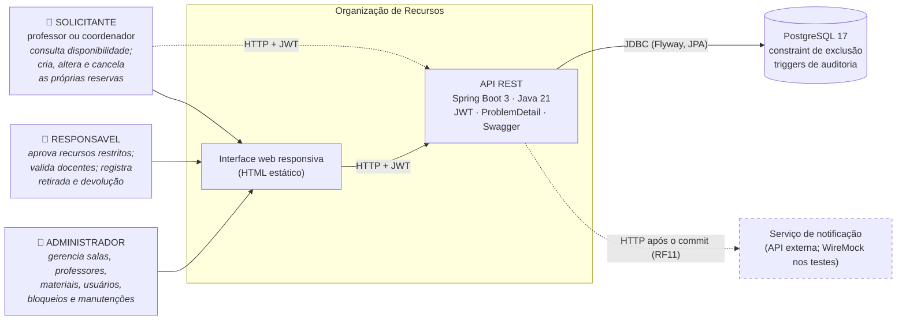
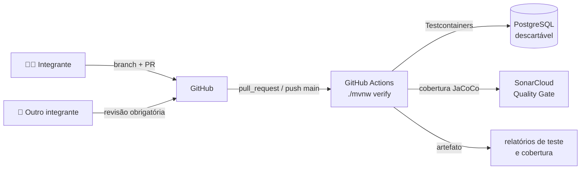

# Diagrama de contexto

Quem usa o sistema e com quais sistemas externos ele conversa. Elementos tracejados ainda não
foram implementados (ver [RTM](../RTM.md)).

| Elemento | Papel | Situação |
|---|---|---|
| Interface web | Telas para os três perfis | Página inicial publicada; telas pendentes (RF13) |
| API REST | Regras de negócio, autenticação e autorização por perfil | Em desenvolvimento ([RTM](../RTM.md)) |
| PostgreSQL | Persistência e **última barreira** das regras críticas (RC01, RC02/RC03/RC04 via constraint de exclusão, RC07 e RC08 via triggers) | Pronto (migrations V1 e V2) |
| Serviço de notificação | Avisar solicitantes sobre aprovação, rejeição e cancelamento. Chamado **depois do commit**: falha na notificação não desfaz a reserva (decisão D9) | Pendente (RF11) |

## Contexto de desenvolvimento

Fora da execução do sistema, o código passa por esta esteira de qualidade:

