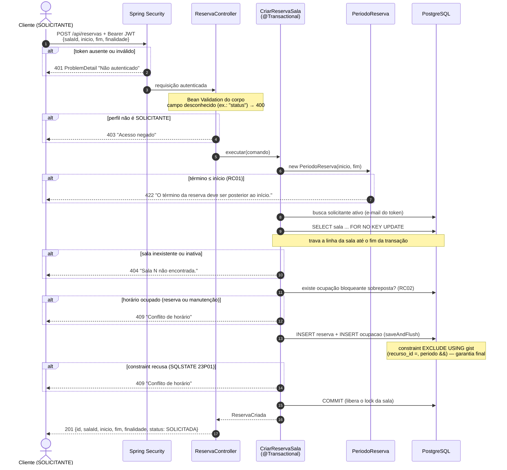
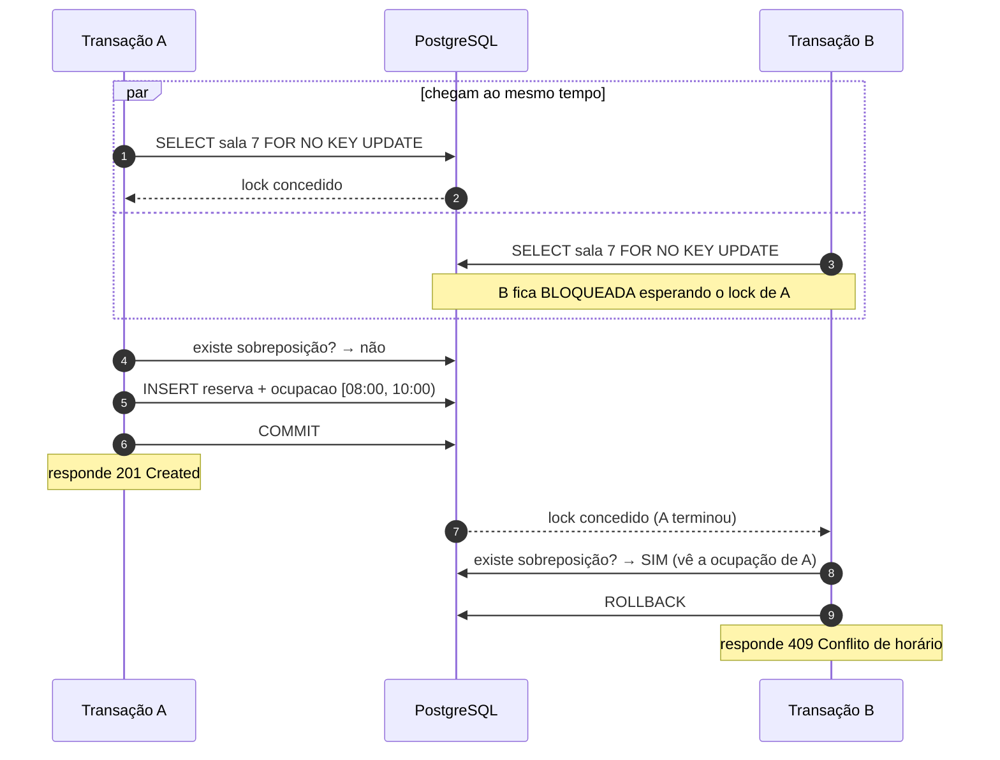

# Sequência: criação de reserva com controle de concorrência

Fluxo de `POST /api/reservas` (RF04) com as regras RC01, RC02 e RC03. Implementado em
[`CriarReservaSala`](../src/main/java/br/senac/qs/recursos/application/reserva/CriarReservaSala.java);
decisões em [arquitetura §3](arquitetura.md).

## Caminho principal e erros

## Duas solicitações simultâneas para a mesma sala e horário (RC03)

O lock da sala faz a segunda transação **esperar** a primeira terminar. Quando ela continua, a
pré-checagem já enxerga a ocupação confirmada (no isolamento `READ COMMITTED`, cada comando vê o
que já foi confirmado) e responde 409, sem deadlock e sem erro 500.

### Por que lock **e** constraint

| Camada | O que garante | O que acontece sem ela |
|---|---|---|
| Lock da sala (`FOR NO KEY UPDATE`) | Serializa reservas do mesmo recurso; 409 com mensagem clara | Inserções conflitantes chegam juntas à constraint, que pode entrar em **deadlock** (`40P01`) e devolver 500. Observado nos testes: 3 de 10 rodadas ([`d485436`](https://github.com/GuilhermeAFSantos/organizacao-recursos/commit/d485436)) |
| Pré-checagem na aplicação | Mensagem de negócio legível | O usuário recebe só a recusa genérica do banco |
| Constraint de exclusão | A regra vale mesmo para código que esqueça o lock, SQL manual ou outra instância | Uma única falha de programação permite dupla reserva |

Evidência automatizada: [`ReservaConcorrenciaIT`](../src/test/java/br/senac/qs/recursos/web/reserva/ReservaConcorrenciaIT.java)
dispara 20 requisições simultâneas em 10 rodadas e exige exatamente 1 resposta 201, 19 respostas 409
e nenhuma 500.
